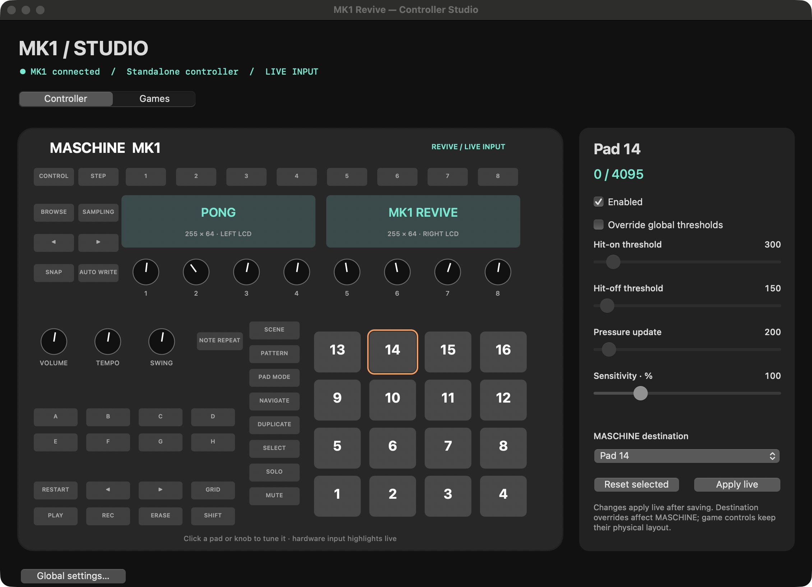
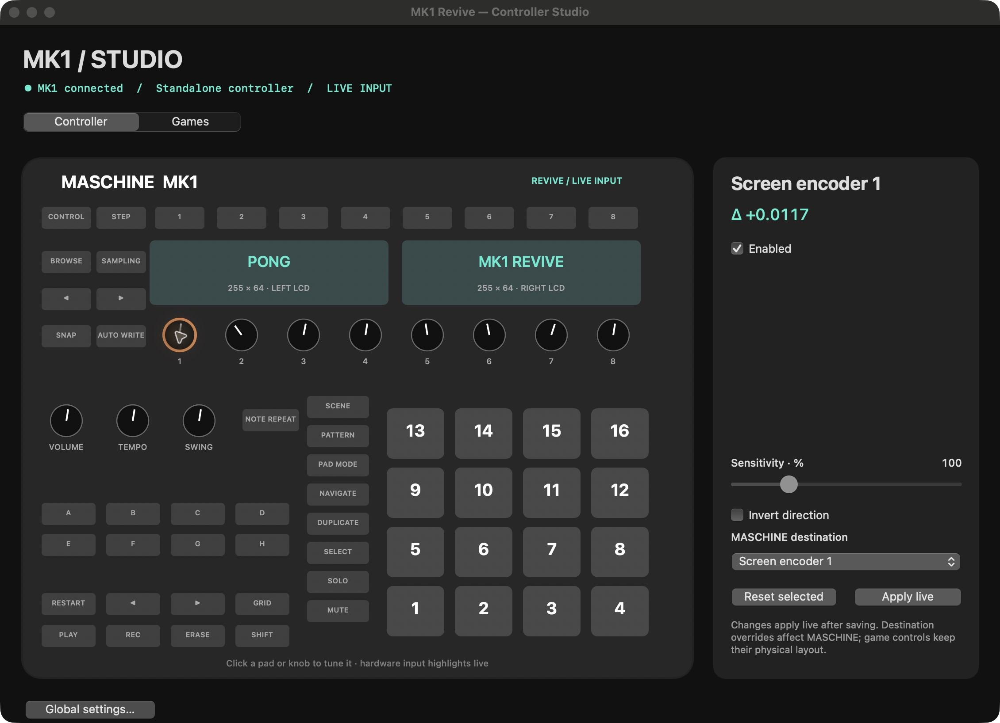
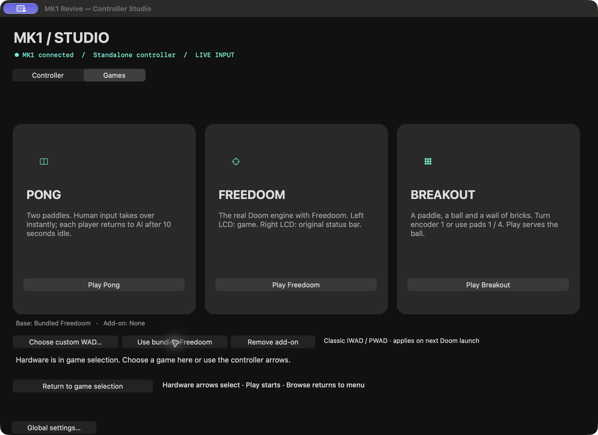
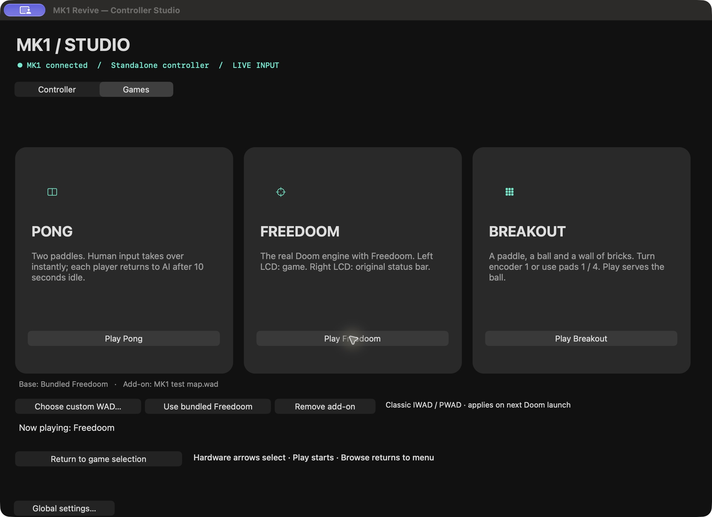
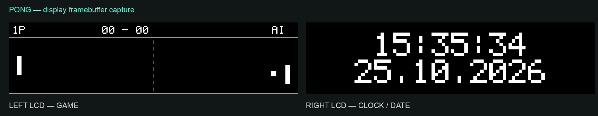
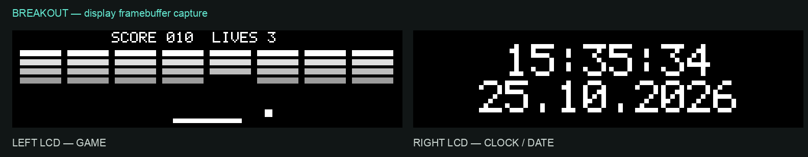
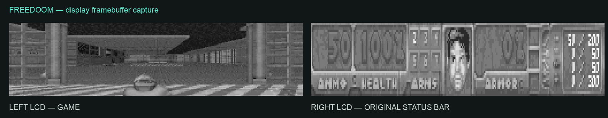

# MK1 Revive — out of SPITE

**SPITE: Saving Products Intended To Expire.**

A perfectly useful MASCHINE MK1 deserves more music, not a retirement date.
So we did it out of SPITE: a userspace controller bridge for Apple Silicon Macs,
with input/display fixes, Controller Studio, and the restored Doom support.

This fork builds on **[Andy83's original MK1 Revive](https://github.com/andy83-projects/maschine-mk1-revive)**.
Andy's userspace USB and MASCHINE integration made this possible. This fork adds
the fixes and features below; the original work and its authors remain credited.

**Support this fork — muumin1nja**

[](https://buymeacoffee.com/muumin1nja)

**Support the original project — Andy83**

[](https://buymeacoffee.com/andy83)

[Download v0.4.0-beta.2](https://github.com/oskarmust/maschine-mk1-revive/releases/tag/v0.4.0-beta.2)
· [Installation](#installation) · [Screenshots](#screenshots)

## Why this fork exists

This started as a repair job for a real MASCHINE MK1. Pads sometimes failed to register or dropped hits, and highlights could appear on the wrong controls. Display updates also left stale content behind. We wanted the controller to behave reliably and the helper to show what the hardware was actually doing.

The fixes decode pad reports by their embedded pad IDs, preserve releases, correct physical control/LED mappings, and retain all pending display updates, including black clears. Controller Studio now follows the MK1 layout and makes input, sensitivity and mapping adjustments visible.

Somehow, we also couldn't find Doom running on the controller. Clearly an oversight. Doom support has therefore been restored — using the Doom engine and Freedoom data, with gameplay on the left display and the original status bar on the right.

<!-- INSTALL:START -->
## Installation

### 1. Check the requirements

- An **Apple Silicon Mac** (M-series), running **macOS 14 or later**.
- A **Native Instruments MASCHINE MK1** and a working USB data connection.
- MASCHINE desktop software installed separately if you want DAW integration.
  This download does not include MASCHINE software or NI sound libraries.
- This release is a **macOS beta**, not an Intel, Windows or iPadOS build.

**Installing the ready-made app does not require Xcode, Python, Homebrew, a
kernel extension or DriverKit.** Those are not installation steps.

### 2. Download the app ZIP

Open [release v0.4.0-beta.2](https://github.com/oskarmust/maschine-mk1-revive/releases/tag/v0.4.0-beta.2)
and expand **Assets** if needed. Download:

**[maschine-mk1-revive-v0.4.0-beta.2-macos-arm64.zip](https://github.com/oskarmust/maschine-mk1-revive/releases/download/v0.4.0-beta.2/maschine-mk1-revive-v0.4.0-beta.2-macos-arm64.zip)**

Choose the file ending in **`macos-arm64.zip`**. The `source.zip` and GitHub's
“Source code” links are for development; they are not the installable app.
Downloads are public and do not require a GitHub account.

Optional integrity check: download **SHA256SUMS** from the same release, run
`shasum -a 256` on the app ZIP, and compare its hash with the matching filename
in that file.

### 3. Put the app in Applications

1. Double-click the downloaded ZIP in Finder to extract it.
2. Drag **MK1 Revive.app** into **Applications** (`/Applications`).
3. Launch that copy from Applications. Do this before opening it for the first
   time: the background bridge is registered using the app's installed path.

Do not run the app directly from Downloads or from inside an archive preview.
For an existing installation, use the update steps below first.

### 4. Complete the first launch

This beta is **ad hoc signed and not notarized**. If macOS blocks the app, first
confirm that you downloaded the ZIP from this repository's release. After trying
to open it, go to **System Settings → Privacy & Security → Open Anyway**, then
confirm **Open** if you choose to trust it. Follow
[Apple's app-opening guidance](https://support.apple.com/en-us/102445).

On the first launch, MK1 Revive automatically creates its user LaunchAgent and
starts the background bridge. Look for the MK1 Revive icon in the **macOS menu
bar**; a permanent Dock icon is not required.

### 5. Verify the controller connection

1. Connect the MK1 using a working USB data cable.
2. Open the menu-bar icon and check for **● Running**. If stopped, choose **Start**.
3. Choose **Controller Studio…**. Check that it reports **MK1 connected**.
4. Hit a pad and turn an encoder. The matching control should highlight and its
   pressure/value should change in the window.
5. Open or restart MASCHINE desktop software with the bridge running. Check its
   controller selection and select the MK1 if necessary.

**Running** means the service is alive; **MK1 connected** confirms that the
hardware was found. Neither alone proves that MASCHINE is receiving input.
Check a real pad response in the software. Audio input/output selection remains
in MASCHINE's normal audio preferences.

Optional: enable **Launch at Login** in the menu-bar app if you want the helper
UI to open when you log in.

### 6. Try the added features

- **Controller Studio…** shows live pads, buttons and encoders. Select a pad or
  encoder to adjust its supported sensitivity/mapping settings, then choose
  **Apply live**. Release held pads before applying changes.
- Choose **Games…** when MASCHINE is not using the controller. Select Pong,
  Freedoom or Breakout in the helper, or use the hardware arrows under
  Browse/Sampling. **Play** starts a game; **Browse** returns to selection.
- Pong gives each idle player to AI after 10 seconds. Turning that player's
  encoder takes control again. Freedoom uses the left LCD for gameplay and
  the right LCD for the original status bar; this beta has no Freedoom audio.

### Choosing a custom Doom WAD

In **Games…**, choose **Choose custom WAD…**:

- An **IWAD** becomes the base game and clears the previous add-on.
- A **PWAD** is loaded as an add-on over the current base game. Doom II map
  packs need a compatible Doom II-style IWAD; the bundled Freedoom is Phase 1.
- **Remove add-on** keeps your selected base. **Use bundled Freedoom** resets
  both choices to the included game data.

The selected WAD is validated and copied into your user Application Support
folder. Changes apply on the next Doom launch; an active Doom session returns
to game selection. Choose **Play Freedoom** to launch the selected configuration.
Classic Doom IWAD/PWAD files up to 256 MiB are supported; PK3 files and mods
requiring GZDoom features are not. No custom game data is downloaded or bundled.

### Updating an existing copy

1. Save your MASCHINE project and quit MASCHINE.
2. In MK1 Revive's menu, choose **Stop**, then **Quit**. Quitting the helper alone
   does not unload the background bridge.
3. Replace `/Applications/MK1 Revive.app` with the app from the new ZIP.
4. Launch the new app from Applications. Choose **Start** if the service is stopped,
   then repeat the controller check above and reopen MASCHINE.

Normal updates do not require deleting your settings or reinstalling MASCHINE.
Do not run the old and new bridge copies together.

### If something does not respond

- **Service stopped:** choose **Start** or **Restart** from the menu-bar app.
- **Service running, hardware missing:** reconnect the data cable and try another
  USB port/adapter, then check Controller Studio again.
- **Hardware reacts in Studio, MASCHINE does not:** restart MASCHINE after the
  bridge is running and check controller selection.
- **Games unavailable:** MASCHINE may be using the controller. Save and quit it,
  then retry Games.

For an issue report, include your macOS/MASCHINE versions, controller connection
state and relevant files from `/tmp/maschine-mk1-revive/`. Do not publish private
project files or unrelated logs.

### Uninstalling

Choose **Stop**, disable **Launch at Login** if enabled, then **Quit**. Move
`/Applications/MK1 Revive.app` to Trash. In Finder's **Go → Go to Folder…**, open
`~/Library/LaunchAgents/` and remove **only** `com.dragco.mk1-bridge.plist` to
prevent it loading at login. Keep settings unless you explicitly want a reset:
`~/Library/Application Support/MK1 Revive/` contains your controller profile.
<!-- INSTALL:END -->

## Controller Studio and idle games

Open **Controller Studio** from the menu bar to see live pads, encoders and
buttons in a matching MK1 layout. Select a pad or encoder to edit its enable
state, gain and MASCHINE destination; pads also support threshold overrides,
and encoders support direction inversion. Release held pads before applying.
The Games view also has **Choose custom WAD…** for a base IWAD or add-on PWAD,
plus **Remove add-on** and **Use bundled Freedoom**. WAD choices persist between
launches. See the [custom WAD instructions](#choosing-a-custom-doom-wad).

Profiles live in `~/Library/Application Support/MK1 Revive/controls.plist`.
The existing global settings remain available in the same window.

The Games tab launches Pong, Freedoom or Breakout when MASCHINE is not using
the controller. The hardware arrows below Browse/Sampling select a game;
Play starts it and Browse returns to the menu. Screen encoder 3 also selects.
Pong switches each paddle to AI after 10 seconds without input; turning its
encoder restores manual control. Breakout uses encoder 1 or pads 1/4, with
Play to serve. Freedoom uses pads 14/10 to move, 9/11 to turn, 13/15 to
strafe, 12 to fire and 16 to use. Gameplay is on the left LCD, its original
status bar on the right. Freedoom audio is disabled.

## Screenshots

**Controller Studio** — MK1 hardware layout with live pad, encoder and button
feedback. Select a pad to inspect its pressure, sensitivity, thresholds and
MASCHINE destination.



**Encoder settings** — select a rotary encoder to adjust gain, invert its
direction or override its MASCHINE destination.



**Game launcher** — start Pong, Freedoom or Breakout from the helper when
MASCHINE is not using the controller. The hardware arrows also select games.



**Custom Doom WADs** — choose a base IWAD or add-on PWAD, remove the add-on,
or restore bundled Freedoom. The selected files are copied and remembered.



### Games on the displays

Actual game renderer output, enlarged with nearest-neighbor scaling for
readability. These are framebuffer captures, not photographs of the LCDs.
Pong and Breakout show the clock/date on the right; Freedoom shows its native
status bar there.

**Pong**



**Breakout**



**Freedoom**



## Building from source (developers only)

Apple Silicon/macOS 14+, Apple's Command Line Tools (`xcode-select --install`),
Python 3 and Git are required. **Full Xcode is optional for this macOS project.**
Building is unnecessary if you install the release ZIP above.

```sh
git clone --recurse-submodules https://github.com/oskarmust/maschine-mk1-revive.git
cd maschine-mk1-revive
sh scripts/build-release-assets.sh
sh scripts/test.sh
```

For an existing clone, run `git submodule update --init --recursive` first.
The build fetches the pinned Freedoom 0.13.0 WAD and checks its SHA-256.
The app is `build/MK1 Revive.app`; release ZIPs are in `dist/`. Install the app
using the same Applications/first-launch steps above. Engine GPL sources and
Freedoom license/credits are retained; see [NOTICE.md](NOTICE.md).

For bridge development after building:

```sh
./build/Release/mk1-bridge --help
```

## Configuration

Use the **Settings…** panel in the MK1 Revive menu bar app, or set environment variables directly in the launchd plist.

### Pad sensitivity

| Env var | Default | Description |
|---------|---------|-------------|
| `MK1_PAD_HIT_ON` | `300` | ADC pressure (0–4095) to trigger a pad strike |
| `MK1_PAD_HIT_OFF` | `150` | ADC pressure must fall below this to register release |
| `MK1_PAD_PRESSURE` | `200` | Minimum change to forward a pressure-update event |
| `MK1_PAD_DEBOUNCE_MS` | `10` | Milliseconds between hit-off and next hit-on |
| `MK1_PAD_SUSTAIN` | `3` | Consecutive above-threshold reports required before hit_on fires |

### Encoder

| Env var | Default | Description |
|---------|---------|-------------|
| `MK1_ENCODER_SENSITIVITY` | `10` | Step multiplier in tenths (10 = ×1.0, 5 = ×0.5, 20 = ×2.0) |
| `MK1_ENCODER_MIN_DELTA` | `2` | Minimum byte-delta per report to register a step (filters jitter) |

### Display & integration

| Env var | Default | Description |
|---------|---------|-------------|
| `MK1_DISPLAY_TICK_MS` | `16` | Display flush interval in ms (16 ≈ 60 fps) |
| `MK1_AUTO_OPEN_MASCHINE` | off | Auto-launch Maschine when bridge starts |
| `MK1_AUTO_CLOSE_MASCHINE` | off | Auto-quit Maschine when bridge stops |

### Diagnostics

| Env var | Default | Description |
|---------|---------|-------------|
| `MK1_VERBOSE_IO` | off | Log every USB bulk transfer |
| `MK1_TIMING_TRACE` | off | Log IPC and USB timing measurements |
| `MK1_PAD_TRACE` | off | Log pad event send results to `timing.log`, without tracing every USB transfer |
| `MK1_PAD_CAPTURE` | unset | Path for a circular raw EP4 capture before filtering; 72-byte records (LE uptime ns + 64 raw bytes), limited to 16 MiB; sort by timestamp after wrap |

## How it works

The MK1 originally required `NIUSBMaschineController.kext` — a kernel extension that never received an ARM64 build. This project replaces it entirely in userspace.

`mk1-bridge` kills the real `NIHardwareAgent` and impersonates it: it registers the `NIHWMainHandler` CFMessagePort itself, performs the full IPC handshake with Maschine software, and owns direct IOKit USB bulk transfers to the hardware.

```
[Maschine.app] ←─CFMessagePort─→ [mk1-bridge] ←─IOKit USB─→ [MK1 hardware]
```

### Components

| Target | Type | Purpose |
|--------|------|---------|
| `mk1-usb` | static lib | Claim USB device, bulk transfers |
| `mk1-ipc` | static lib | CFMessagePort handshake + NI IPC protocol |
| `mk1-bridge` | daemon | Glues USB ↔ IPC, runs as launchd agent |
| `mk1-menubar` | app bundle | Menu bar app: service control + settings |
| `mk1-shim` | dylib | DYLD_INSERT_LIBRARIES shim for debugging |

## Prior art

- **[biappi/Macchina](https://github.com/biappi/Macchina)** — Reverse engineered the CFMessagePort handshake between NIHardwareAgent and Maschine software (MK1, 2012).
- **[SamL98/NIProtocol](https://github.com/SamL98/NIProtocol)** — Full MK2 handshake; `NIHWMainHandler` port name; complete client + server in C. ([article](https://lerner98.medium.com/rage-against-the-maschine-3357be1abc48))
- **[terminar/rebellion](https://github.com/terminar/rebellion)** — Most complete IPC implementation (MK3/KK); key insight that USB and IPC data share the same format.
- **[fzero/maschine-mk1](https://github.com/fzero/maschine-mk1)** — MK1 HID protocol on Linux; confirms VID `0x17CC` / PID `0x0808`.
- **[hansfbaier/open-maschine](https://github.com/hansfbaier/open-maschine)** — MK2 proof-of-concept using hidapi.

## Upstream changelog (before this fork)

### v0.3.3 — 2026-04-24
- Fix invisible tractor beam in idle animation — grey pixel values render as black on this display; replaced with white alternating scanlines

### v0.3.2 — 2026-04-23
- UFO tractor beam idle animation: small cat stands at bottom of left display while a UFO sweeps back and forth, homes in, fires a tractor beam, sucks the cat up, flies around, and returns the cat to the ground (~26.8 s loop)

### v0.3.1 — 2026-04-20
- Fix rogue pad hits from scan table reports leaking into the pad pressure classifier
- Fix orphaned hit-off events caused by `was_active` tracking pressure state instead of sent-event state
- Improve scan table classifier: compare top nibbles only, require both ADC channels to agree

### v0.3.0 — 2026-04-17
- Fix pad stuck notes and bounce: sustain gate, reliable hit_off retry, hit_on conditional on IPC success
- Fix encoder direction reversal; filter single-count jitter; suppress electrical crosstalk between adjacent encoders

### v0.2.1 — 2026-04-16
- Move logs to `/tmp/maschine-mk1-revive/`; cap at 10 MiB with wraparound

### v0.2.0 — 2026-04-14
- MK1 Revive menu bar app: service management and settings panel
- Runtime-configurable pad thresholds and encoder sensitivity via env vars
